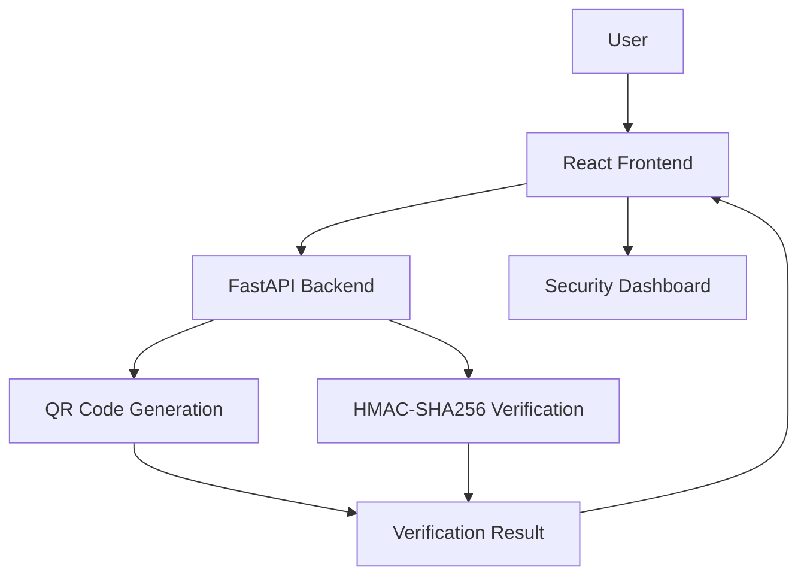

# 🛡️ QRShield – QR Payment Integrity Simulator

<p align="center">
  <b>A QR Code Payment Integrity and Tampering Detection Project</b>
</p>

<p align="center">
  
  
  
  
</p>

---

## 📌 About the Project

**QRShield** is a QR payment integrity simulation project designed to demonstrate how QR code payment information can be generated, checked, and verified.

The project explores security risks associated with QR-based payments, including unauthorized modifications and fraudulent QR codes.

It uses QR code generation and HMAC-based verification to demonstrate the importance of data integrity in digital payment systems.

## 🎯 Objectives

- Understand security risks associated with QR-based payments.
- Generate QR codes for payment information.
- Demonstrate detection of modified payment data.
- Apply cryptographic integrity verification.
- Build a simple web-based security dashboard.

## ✨ Key Features

- QR code generation.
- QR payment data verification.
- HMAC-SHA256-based integrity checking.
- Self-test functionality.
- Dashboard for displaying security information.
- Backend API integration.
- Payment integrity simulation.

*Note: Keep only features that are currently implemented and working.*

## 🏗️ System Architecture



## 🛠️ Technology Stack

| Component | Technology |
|---|---|
| Frontend | React |
| Programming Language | TypeScript |
| Styling | Tailwind CSS |
| Backend | Python |
| Backend Framework | FastAPI |
| QR Processing | Existing QR generation library |
| Security | HMAC-SHA256 |
| Development Tools | VS Code, Git, GitHub |

## 🔄 Project Workflow

1. The user enters payment-related information.
2. The frontend sends the information to the backend.
3. The backend processes the payment data.
4. A QR code is generated.
5. HMAC-based verification checks data integrity.
6. The result is returned to the frontend.
7. The dashboard displays the verification result.

## 📂 Project Structure

```text
QRShield/
│
├── backend/
│   ├── main.py
│   └── ...
│
├── frontend/
│   └── ...
│
├── .venv/
├── package.json
├── pnpm-workspace.yaml
├── README.md
└── .gitignore
```

*The structure above is illustrative. Update it to match the actual repository.*

## ⚙️ Installation and Setup

### Prerequisites

- Python
- Node.js
- pnpm
- Git

### 1. Clone the Repository

```bash
git clone https://github.com/Ajnaaditi30/QR-Payment-Integrity-Simulator.git
```

```bash
cd QR-Payment-Integrity-Simulator
```

*Replace the repository URL and folder name if they differ from your actual GitHub repository.*

### 2. Set Up the Python Environment

```powershell
python -m venv .venv
.\.venv\Scripts\Activate.ps1
```

### 3. Install Backend Dependencies

```powershell
pip install -r requirements.txt
```

### 4. Configure Environment Variable

```powershell
$env:QRSHIELD_HMAC_SECRET="your-own-long-random-secret"
```

Never publish your actual secret in GitHub.

### 5. Start the Backend

```powershell
python -m uvicorn backend.main:app --host 127.0.0.1 --port 8080
```

### 6. Start the Frontend

Open a second terminal:

```powershell
pnpm install
pnpm --filter @workspace/qrshield dev
```

Open the application:

```text
http://localhost:5173/
```

## 🔐 Security Concept

**HMAC-SHA256 (Hash-Based Message Authentication Code)** is a cryptographic mechanism used to verify the integrity and authenticity of data using a shared secret key.

In this project, HMAC verification is used to demonstrate whether payment data has been modified after generation.

## ⚠️ Limitations

- This is an academic simulation project, not a production payment security solution.
- HMAC verification depends on secure secret management.
- A successful integrity check does not independently prove that a merchant or payment recipient is genuine.
- The project does not replace bank or payment-provider security systems.

## 🚀 Future Scope

- Merchant identity verification.
- Suspicious QR code detection.
- Integration with trusted merchant information.
- Improved fraud-risk analysis.
- Cloud deployment and monitoring.

## 🎓 Learning Outcomes

- Understanding QR code payment workflows.
- Learning API integration between frontend and backend.
- Applying HMAC-based data integrity verification.
- Understanding basic cybersecurity concepts.
- Building a full-stack web application.

## 👩‍💻 Contributors

- Aaditi Ajnadkar
- [Add other team members, if applicable]

## 📄 License

No open-source license has been specified yet.

---

<p align="center">
  <b>QRShield – Exploring Security and Integrity in QR-Based Payments</b>
</p>
