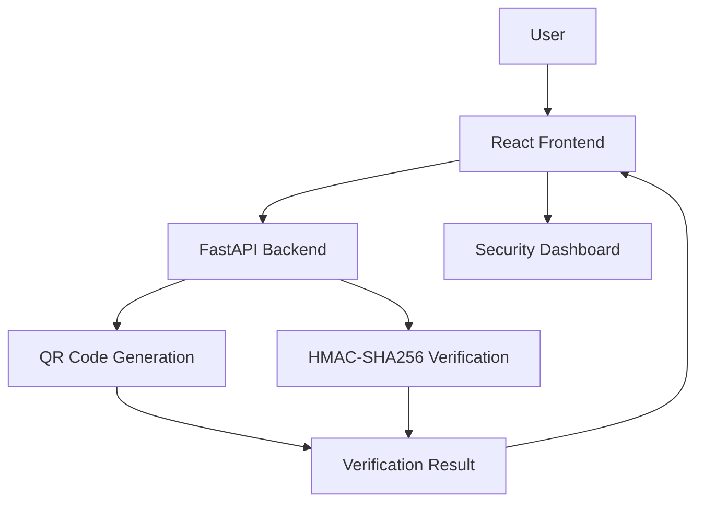

# 🛡️ QRShield – QR Payment Integrity Simulator

<p align="center">
  
</p>

<h3 align="center">A Cybersecurity-Based QR Payment Integrity Simulation System</h3>

<p align="center">
  
  
  
  
</p>

---

## 📌 About the Project

**QRShield** is a web-based QR payment integrity simulation project that demonstrates how QR payment information can be generated and verified against unauthorized modifications.

With the increasing use of QR codes in digital payments, protecting payment information from tampering is important.

QRShield demonstrates the use of **HMAC-SHA256 cryptographic verification** to check the integrity and authenticity of payment data.

The application provides a dashboard to simulate QR generation, verification, and security testing.

## 🎯 Objectives

- Understand security risks associated with QR-based payments.
- Generate QR codes containing payment information.
- Detect unauthorized modifications to payment data.
- Demonstrate cryptographic integrity verification.
- Integrate a frontend dashboard with a backend API.
- Explore practical cybersecurity concepts.

## ✨ Key Features

- QR code generation.
- HMAC-SHA256-based payment data verification.
- Payment integrity checking.
- Tampering simulation.
- Security self-test functionality.
- Interactive dashboard.
- Frontend and backend API integration.

*Only retain features that are actually implemented and working in your current version.*

---

## 📸 Project Screenshots

### 1. Main Dashboard

The main dashboard provides an overview of the QRShield application and its security-related features.


### 2. QR Code Generation

Demonstrates the generation of QR codes using payment-related information.


### 3. Payment Verification

Shows the verification process used to check the integrity of payment information.


### 4. Tampering Simulation

Demonstrates how modified payment information can be identified through integrity verification.


### 5. Security Self-Test

Shows the self-test interface and its verification results.


---

## 🏗️ System Architecture



### Architecture Components

| Component | Responsibility |
|---|---|
| Frontend | User interaction and dashboard |
| Backend | Handles QR generation and verification |
| QR Generator | Generates payment QR codes |
| HMAC Verification | Checks payment data integrity |
| API | Connects frontend and backend |

## 🛠️ Technology Stack

| Technology | Purpose |
|---|---|
| React | Frontend development |
| TypeScript | Frontend programming |
| Tailwind CSS | User interface styling |
| Python | Backend programming |
| FastAPI | Backend API framework |
| HMAC-SHA256 | Cryptographic integrity verification |
| Git & GitHub | Version control |

*Add QR-processing libraries and AWS services only if they are actually used in your implementation.*

---

## 🔄 Working Workflow

1. The user enters payment-related information.
2. The frontend sends the information to the backend.
3. The backend processes the payment data.
4. The QR code is generated.
5. HMAC-based verification checks the integrity of the data.
6. The backend returns the verification result.
7. The frontend displays the result on the dashboard.

## 🔐 Security Concept Used

### HMAC-SHA256

HMAC stands for Hash-Based Message Authentication Code.

It uses a secret key and a cryptographic hash function to verify data integrity and authenticity.

In QRShield, HMAC-SHA256 is used to demonstrate whether payment information has been modified after its generation.

**Important:** HMAC verification alone does not prove that the payment recipient is a genuine merchant. It verifies data against a trusted secret.

---

## 📂 Project Structure

```text
QRShield-Payment-Integrity-Simulator/
│
├── backend/
│   ├── main.py
│   └── ...
│
├── frontend/
│   └── ...
│
├── .venv/
├── package.json
├── pnpm-workspace.yaml
├── .gitignore
└── README.md
```

*This is an illustrative structure. Update it to match your actual repository.*

## ⚙️ Installation and Setup

### Prerequisites

Install the following before running the project:

- Python
- Node.js
- pnpm
- Git

### Step 1: Clone the Repository

```bash
git clone https://github.com/Ajnaaditi30/QRShield-Payment-Integrity-Simulator.git
```

```bash
cd QRShield-Payment-Integrity-Simulator
```

### Step 2: Create Python Virtual Environment

```powershell
python -m venv .venv
```

Activate the environment:

```powershell
.\.venv\Scripts\Activate.ps1
```

### Step 3: Install Backend Dependencies

```powershell
pip install -r requirements.txt
```

### Step 4: Configure Environment Variable

Set the HMAC secret in PowerShell:

```powershell
$env:QRSHIELD_HMAC_SECRET="your-own-long-random-secret"
```

Do not upload your actual secret to GitHub.

### Step 5: Start the Backend

```powershell
python -m uvicorn backend.main:app --host 127.0.0.1 --port 8080
```

### Step 6: Start the Frontend

Open a second terminal:

```powershell
pnpm install
```

```powershell
pnpm --filter @workspace/qrshield dev
```

Open the application in your browser:

**http://localhost:5173/**

---

## 🔌 Backend API

QRShield uses FastAPI to handle frontend requests.

The API includes endpoints for application health, QR generation, security testing, and dashboard data.

| Endpoint | Purpose |
|---|---|
| `/api/health` | Backend health check |
| `/api/stats` | Dashboard statistics |
| `/api/history` | Activity history |
| `/api/security/self-test` | Security self-test |

*Verify the actual HTTP methods and endpoint paths in your backend source code before publishing.*

## 🧪 Testing

The project includes backend testing and a security self-test to demonstrate QR generation and integrity verification.

Testing should cover:

- QR code generation.
- Valid payment data verification.
- Modified payment data verification.
- Backend API availability.
- Frontend and backend connectivity.

Add only test results that you have actually verified.

## ⚠️ Limitations

- QRShield is an academic simulation, not a production payment security system.
- HMAC verification requires secure secret management.
- HMAC does not independently verify merchant identity.
- The project does not replace official banking or payment-provider security mechanisms.

## 🚀 Future Scope

- Verified merchant identity integration.
- Suspicious QR payment detection.
- Integration with trusted merchant information.
- Improved fraud-risk analysis.
- Cloud deployment and monitoring.
- Additional security testing.

## 🎓 Learning Outcomes

- Understanding QR-based payment workflows.
- Learning frontend and backend integration.
- Working with REST APIs.
- Understanding HMAC-SHA256.
- Applying cryptographic integrity verification.
- Developing a full-stack cybersecurity application.

## 👩‍💻 Contributors

**Aaditi Ajnadkar**

Add other team members here if applicable.

## 📄 License

No open-source license has been specified for this repository.

---

<p align="center">
  <b>QRShield – Exploring Integrity and Security in QR-Based Payments</b>
  <br>
  Built as an Academic Cybersecurity Project
</p>
